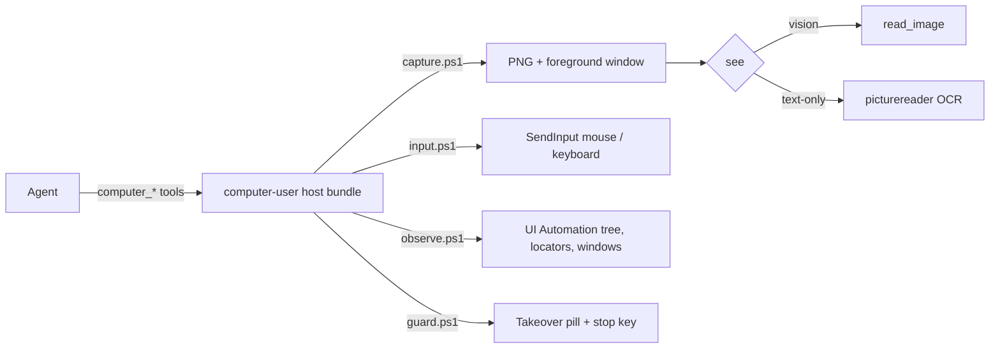

<div align="center">

# computer-user

**Codex-style computer use for DeepSeek Harness on Windows.**
The agent sees the screen, clicks, types — or drives named controls through UI Automation. No sidecar, no native build.

[](https://www.npmjs.com/package/computer-user)
[](https://www.npmjs.com/package/computer-user)
[](LICENSE)
[](#compatibility)
[](#development)

English | [中文](README.zh.md)


</div>

`computer-user` is a [DeepSeek Harness](https://github.com/deepseek-ai/deepseek-harness) bundle that gives an agent
twenty-one `computer_*` tools: screenshot, UI Automation tree, pointer and keyboard input, window control, and a
takeover pill with a global stop key that follows you across virtual desktops.

It ships as a normal DSH plugin — `package.json`, one `cordis.patch.yml`, a settings card, and three PowerShell
scripts. No native addon, no daemon process, no MCP bridge.

## Why this one

- **Native DSH bundle, not a bridge.** Tools register through `ctx.tools.register`; settings ride the 0.2.x
  `SettingsForms` entry; the Web card is a first-class settings section, not a separate page.
- **Zero native dependencies.** Input uses `SendInput`, capture uses GDI, observation uses UI Automation —
  all through Windows PowerShell 5.1 that ships with the OS.
- **Vision optional.** `computer_screenshot` returns a PNG path: vision models call `read_image`, text-only
  models use picturereader OCR, and `computer_snapshot` acts on named controls without any pixels.
- **Stops when asked.** A blue pill appears while the agent has control; the stop key (default `Ctrl+Alt+Esc`)
  or its button writes a stop flag that every later call refuses to ignore. When a task is done the agent can
  close the pill itself with `computer_stop` (the approval survives), and the pill follows virtual-desktop switches.
- **Stale-safe.** Element ids are re-resolved on every action, and a screenshot can be fenced on the
  foreground window — a changed UI fails loudly instead of clicking the wrong thing.

## Quick start

npm:

```sh
npm install computer-user
```

DSH profile:

```sh
dsh plugin --profile desktop add computer-user
```

Restart DSH. The tools appear in every session; the card appears under Settings → Computer Use.

From a checkout:

```sh
git clone https://github.com/jing-hy/computer-user.git
cd computer-user
npm install --no-save @deepseek-ai/schemastery@3.18.5   # peer, provided by the host at runtime
node --test
```

## The loop

```text
computer_screenshot            -> PNG path + foreground window
read_image(path)               -> vision models see it   (text-only: image_ocr / image_scan)
computer_snapshot              -> UI Automation tree, one replayable id per element
computer_invoke / set_value    -> act on a named control, pointer untouched
computer_screenshot            -> verify (optionally fenced with expected_window)
```

Coordinate work still works: every input tool takes virtual-screen pixels, and `computer_screenshot`
returns `virtual_offset` so multi-monitor rigs line up.

## Tools

Twenty-one tools. `tool_mode` can trim the set to nine everyday ones.

| Group | Tools |
|---|---|
| Observe | `computer_screenshot`, `computer_snapshot`, `computer_list_windows`, `computer_get_cursor_position` |
| Act with the pointer | `computer_click`, `computer_type`, `computer_keypress`, `computer_scroll`, `computer_drag`, `computer_move_mouse` |
| Act on controls | `computer_invoke`, `computer_set_value`, `computer_focus` |
| Windows | `computer_activate_window`, `computer_move_window`, `computer_close_window` |
| Timing | `computer_wait` — sleep, or wait until a window / element / title substring appears |
| Runtime | `computer_doctor`, `computer_browser` (read-only CDP list), `computer_set_mode` |
| Wrap-up | `computer_stop` — close the pill and end the takeover (approval kept; `hard: true` is a real stop) |

Element ids look like `h=<hwnd>|r=<Role>|n=<Name>|i=<nth>|a=<autoId>`. They are resolved again on every
action, so a locator from a stale snapshot errors instead of hitting whatever moved under it. `a=` is the
control automation id and outranks the occurrence index, which drifts between a shallow snapshot and a deeper walk.

## How it shows up in DSH

- The plugin inventory shows **Computer Use** with a blue cursor icon (`locale/en.json`, `package.json.icon`).
- The slash menu shows `[hollow cursor] 电脑操作 computer · 批准或撤销电脑操作`. The label and glyph are
  decorated client-side: the Host command schema only accepts `name` / `description`, and icons plus localized
  labels live in a private client table, so a plugin cannot declare them.
- The settings card lives at Settings → Computer Use.

## Settings

This card writes the plugin entry Config (all fields hot-reloadable).

| Field | Default | What it does |
|---|---|---|
| `mode` | `manual` | `disabled` refuses everything; `readonly` allows observation only; `manual` needs `/computer`; `auto` lets the model act freely |
| `ai_can_change_mode` | `false` | Whether `computer_set_mode` may switch modes on its own |
| `screenshot_dir` | empty | Output directory for screenshots (empty = OS temp) |
| `default_scale` | `1` | Default screenshot downscale, 0.1–1 |
| `typing_interval_ms` | `0` | Delay between characters while typing |
| `scroll_units` | `1` | Wheel notches per `computer_scroll` (120 WHEEL delta each) |
| `output_guard` | `true` | Strips fake tool-call/XML text written as conversation; same text passes on the second output |
| `debug` | `false` | Logs the PowerShell script paths |
| `tool_mode` | `all` | `all` / `lite` / `custom` |
| `enabled_tools` | `[]` | Allow-list used with `custom` (empty = all) |
| `stop_hotkey` | `ctrl+alt+esc` | Key shown on the pill; the pill button always works |
| `takeover_minutes` | `30` | The pill auto-dismisses (and stops) after this long; `0` never auto-dismisses |
| `takeover_message` | empty | Pill title; `{key}` is replaced with the hotkey |
| `cdp_port` | `0` | Chromium `--remote-debugging-port` for `computer_browser` (`0` = off) |
| `approve_observe` | `false` | When on, screenshots / UIA snapshots / window lists also need `/computer` in `manual` |

## Safety model

- **Modes.** `disabled` / `readonly` / `manual` / `auto`. Observation tools stay available in `readonly`.
- **Session approval.** In `manual`, side-effecting tools refuse until the user types `/computer` in that
  session; typing it again revokes the approval.
- **Takeover pill and stop key.** Any side-effecting call raises the pill. The hotkey, the pill button, or a
  timeout writes a stop flag; every later call fails with an explicit "stopped" error until the user approves
  again. The pill is its own process, so the key lands even while the input backend is busy.
- **Observation gating (optional).** `approve_observe` extends the approval requirement to screenshots and
  UI snapshots, for setups where looking at the screen is itself sensitive. Off by default.
- **Stale rejection.** Locator resolution and the optional `expected_window` fence.

## How it works



The host half registers tools and reads its own Config entry; the browser half (`client.js`) renders the
settings card through `ctx.configForms` and the official settings-form vocabulary.

## Compatibility

| DSH | Status |
|---|---|
| 0.2.0-rc.1 … 0.2.2-alpha.2 | Supported; the version gate is `@deepseek-ai/dsh-settings >=0.1.0-rc.6 <0.3.0-0` |
| 0.1.0-rc.6 … 0.1.7-rc.2 | Supported through the 0.1.x namespaced settings scope |
| 0.3.0 and later | Out of range until verified against that kernel |

Windows 10/11 x64. The screenshots and UIA paths were verified on Windows PowerShell 5.1.

## Development

```sh
node --test                      # 78 tests: tools, gates, guard, settings card, entry shape
```

Layout: `src/index.js` (entry, commands, output guard), `src/tools.js` (tool surface and gates),
`src/ps.js` (PowerShell runner + guard state), `src/capture.ps1` / `src/input.ps1` / `src/observe.ps1` /
`src/guard.ps1`, `client.js` (settings card), `tests/`.

## License

[MIT](LICENSE)
