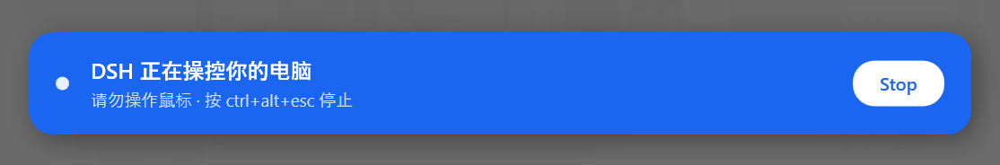
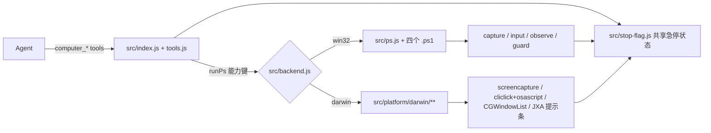

<div align="center">

# computer-user

**给 DeepSeek Harness 的电脑操控插件（Codex 风格）。**
模型看屏幕、点鼠标、敲键盘；Windows 上还能按名字操作 UI Automation 控件。macOS 是实验性后端。
没有 sidecar，不需要编译原生模块。

[](https://www.npmjs.com/package/computer-user)
[](https://www.npmjs.com/package/computer-user)
[](LICENSE)
[-0078D4)](#平台支持)
[](#开发)

[English](README.en.md) | 中文（默认）



</div>

`computer-user` 是 [DeepSeek Harness](https://github.com/deepseek-ai/deepseek-harness) 的一个 bundle，给 agent 提供
二十一个 `computer_*` 工具：截图、控件树（Windows）、鼠标键盘输入、窗口控制、条件等待，以及一个
「agent 正在操控」的接管提示条。

它就是一个普通 DSH 插件：`package.json` + 一份 `cordis.patch.yml` + 设置卡，后端按平台切换 ——
Windows 走四个 PowerShell 脚本（系统自带 PowerShell 5.1 + GDI + UI Automation + WPF），
macOS 走系统自带 `screencapture` / `osascript`，指针操作可选装 `cliclick`。
没有原生插件、没有常驻 daemon、不走 MCP 桥。

## 平台支持

| 能力 | Windows 10/11 | macOS（实验性） |
|---|---|---|
| 截图（全屏 / region / 缩放） | ✅ 多屏虚拟原点、DPI 感知 | ✅ 主屏；Retina 自动折算成「点」 |
| 鼠标 点击 / 右键 / 双击 / 拖动 / 滚动 / 取光标 | ✅ `SendInput` | ✅ 指针操作需 `brew install cliclick`；滚动用 JXA 无需依赖 |
| 键盘 组合键 / 中英文输入 | ✅ `SendInput` Unicode | ✅ AppleScript `keystroke` / `key code` |
| 窗口 列表 / 前台 / 激活 | ✅ Win32 + UIA | ✅ `CGWindowList` |
| 窗口 移动 / 关闭 | ✅ | ❌ 明确报错（需 AX API） |
| 控件树 `snapshot` / `invoke` / `set_value` / `focus` | ✅ UI Automation | ❌ 明确报错（需 AX API + 授权） |
| 条件等待 `computer_wait`（窗口 / 标题） | ✅ | ✅ |
| 接管提示条 + 停止按钮 + 超时急停 | ✅ WPF | ✅ JXA/AppKit 浮窗，**点提示条任意位置即停止** |
| 全局停止热键 | ✅ `RegisterHotKey` | ⚠️ 默认关闭（`CGEventTap` 需 C 回调，见 `docs/mac-backend.md`） |
| `computer_browser`（CDP 只读列表） | ✅ | ✅（平台无关） |

macOS 是**实验性**的：实现与单测都齐了（160 项全绿），但没有 Mac 真机跑过。能力边界、契约与
真机验证清单写在 [docs/mac-backend.md](docs/mac-backend.md)。

### macOS 首次使用

在「系统设置 → 隐私与安全性」里给**宿主应用（DeepSeek Harness）**授权，然后重启 DSH：

| 权限 | 为什么需要 |
|---|---|
| **屏幕录制** | 没有它 `screencapture` 拿不到画面 |
| **辅助功能** | 没有它合成键鼠事件被丢弃、窗口信息读不全 |
| **输入监控** | 只有启用全局停止热键时才需要（当前默认关闭） |

可选：`brew install cliclick` 提升指针操作（没有它时点击类工具会直接告诉你装什么，键盘与滚动仍然可用）。
`computer_doctor` 会报告当前后端、macOS 版本、三个工具是否在 PATH 上，以及 `dpr_unverified`（Retina 折算是否已确认）。

## 为什么选这个

- **原生 DSH bundle，不是转接层。** 工具走 `ctx.tools.register`；设置走 0.2.x 的 `SettingsForms` 条目；
  Web 卡片是一等公民的 settings section，而不是另开一页。
- **零原生依赖。** Windows 侧输入用 `SendInput`、截图用 GDI、观测用 UI Automation、提示条用 WPF，
  全部走系统自带的 Windows PowerShell 5.1；macOS 侧只用系统自带的 `screencapture` / `osascript`
  （指针注入是唯一需要可选第三方 `cliclick` 的地方）。
- **视觉可选。** `computer_screenshot` 返回 PNG 路径：有视觉的模型调 `read_image`，纯文本模型用
  picturereader 的 OCR；Windows 上 `computer_snapshot` 还能完全不看像素、直接按控件名操作。
- **叫停就停。** agent 接管期间屏幕上方会出现提示条。Windows：停止热键（默认 `Ctrl+Alt+Esc`）或点按钮；
  macOS：点提示条任意位置。都会写停止标记，之后除 `computer_doctor` 外的调用一律明确拒绝，
  错误文案会说明是「超时自动急停」还是「用户按了停止键」。再按一次 `/computer` 即可恢复。
- **不会点到旧位置。** 控件 locator 每次动作都重新解析，截图还可以用 `expected_window` 做前台窗口围栏 ——
  界面变了就直接报错，而不是点到挪过去的新控件。

## 快速开始

npm：

```sh
npm install computer-user
```

装进 DSH profile：

```sh
dsh plugin --profile desktop add computer-user
```

重启 DSH：工具在所有会话可用，设置卡出现在「设置 → 电脑操作」。

从源码：

```sh
git clone https://github.com/jing-hy/computer-user.git
cd computer-user
npm install --no-save @deepseek-ai/schemastery@3.18.5   # peer 依赖，运行时由宿主提供
node --test                                             # 160 项
```

## 闭环

```text
computer_screenshot            -> PNG 路径 + 前台窗口（+ virtual_offset）
read_image(path)               -> 有视觉的模型直接看图（纯文本用 image_ocr / image_scan）
computer_snapshot              -> Windows：UI Automation 控件树，每个元素一个可重放 id
computer_invoke / set_value    -> Windows：按名字操作控件，不动鼠标
computer_click / type          -> 双平台：按坐标操作（macOS 的截图已折算成「点」，坐标可直接用）
computer_screenshot            -> 验证（可传 expected_window 做围栏）
```

坐标方式在 Windows 上同样是第一等的：所有输入工具都收虚拟屏像素，`computer_screenshot` 返回
`virtual_offset`，多屏也对得上。

## 工具

二十一个工具。`tool_mode` 可以收敛到 9 个常用工具（`lite`）。

| 分组 | 工具 |
|---|---|
| 观测 | `computer_screenshot`、`computer_snapshot`¹、`computer_list_windows`、`computer_get_cursor_position` |
| 指针与键盘 | `computer_click`、`computer_type`、`computer_keypress`、`computer_scroll`、`computer_drag`、`computer_move_mouse` |
| 控件操作 | `computer_invoke`¹、`computer_set_value`¹、`computer_focus`¹ |
| 窗口 | `computer_activate_window`、`computer_move_window`¹、`computer_close_window`¹ |
| 等待 | `computer_wait` —— 固定等待，或等到窗口 / 标题（Windows 还支持等到控件）出现 |
| 运行时 | `computer_doctor`、`computer_browser`（只读 CDP 列表）、`computer_set_mode` |
| 收尾 | `computer_stop` —— 关掉提示条、结束本次接管（保留批准；`hard: true` 才是急停） |

¹ 仅 Windows。macOS 上调用会返回「暂不支持 + 需要 AX API」的明确错误。

元素 id 形如 `h=<hwnd>|r=<Role>|n=<Name>|i=<nth>|a=<autoId>`，每次动作都重新解析 —— 旧快照里的 locator
会报错，而不是点到挪过去的新控件。`a=` 是 automation id，优先级高于序号：浅层快照和深层重走之间 `i=`
会漂移，`a=` 不会。

## 在 DSH 界面里的样子

- 插件清单显示为「电脑操作」+ 蓝色光标图标（`locale/zh.json`、`locale/en.json`、`package.json.icon`）。
- 斜杠菜单里显示为 `[空心光标] 电脑操作 computer · 批准或撤销电脑操作`。名字和图标是 client 侧装饰出来的
  —— 宿主的命令 schema 只收 `name` / `description`，图标与本地化标签在官方私有表里，插件注入不进去。
- 设置卡在「设置 → 电脑操作」。

## 设置

这张卡写的是插件条目的 Config（所有字段都可热改）。

| 字段 | 默认 | 作用 |
|---|---|---|
| `mode` | `manual` | `disabled` 全拒；`readonly` 只允许观测；`manual` 需要 `/computer`；`auto` 自由调用 |
| `ai_can_change_mode` | `false` | AI 能否通过 `computer_set_mode` 自己改模式 |
| `screenshot_dir` | 空 | 截图输出目录（空 = 系统临时目录） |
| `default_scale` | `1` | 截图默认缩放 0.1–1 |
| `typing_interval_ms` | `0` | 逐字输入间隔（双平台） |
| `scroll_units` | `1` | 每次滚动的格数（Windows 每格 120 WHEEL delta；macOS 每格 3 行） |
| `output_guard` | `true` | 把伪工具调用/XML 写成对话文本时打回；同内容第二次放行 |
| `debug` | `false` | 日志里打印当前后端与脚本路径 |
| `tool_mode` | `all` | `all` / `lite` / `custom` |
| `enabled_tools` | `[]` | `custom` 时的白名单（空 = 全部） |
| `stop_hotkey` | `ctrl+alt+esc` | 提示条上显示的停止热键（**仅 Windows 生效**；macOS 用点提示条 / `/computer` 停止） |
| `takeover_minutes` | `30` | 提示条多久后自动收起（并急停）；`0` = 不自动收起 |
| `takeover_message` | 空 | 提示条标题；`{key}` 会替换成热键 |
| `cdp_port` | `0` | Chromium `--remote-debugging-port`，供 `computer_browser` 使用（`0` = 关闭） |
| `approve_observe` | `false` | 开启后，截图 / 控件快照 / 窗口列表在 `manual` 模式下也要 `/computer` |

## 安全模型

- **模式。** `disabled` / `readonly` / `manual` / `auto`；`readonly` 下观测工具仍然可用。
- **会话批准。** `manual` 下副作用工具拒绝执行，直到用户在该会话输入 `/computer`；再输一次撤销批准。
- **接管提示条与停止标记。** 任何副作用调用都会拉起提示条。停止标记一旦写入，除 `computer_doctor` 外的
  调用全部返回「已急停」，文案会区分超时 / 热键 / 按钮；再按一次 `/computer` 清除标记并恢复
  （已批准的会话直接恢复，不必先撤销再批准）。提示条是独立进程，输入后端忙时停止依然有效。
- **观测也可以要求批准（可选）。** `approve_observe` 把批准要求扩展到截图与控件快照 —— 适合「看一眼屏幕
  本身也敏感」的场景。默认关闭。
- **过期拒绝。** locator 每次重新解析；截图可加 `expected_window` 围栏。

## 工作原理



平台判断只出现在 `src/backend.js` 一处；`src/tools.js`（工具面与门禁）完全不认识平台。
两个后端暴露同一个表面（`runPs` / `ensureGuard` / `stopGuard` / 急停状态），
所以 `/computer`、`computer_stop`、超时恢复这些语义在两个平台是同一份代码。

## 仓库结构

```text
src/
  index.js              入口：apply、/computer、输出守卫
  tools.js              21 个工具 + 模式/批准门禁（平台无关）
  backend.js            唯一的平台分叉点：win32 → ps.js，darwin → platform/darwin/**
  stop-flag.js          跨平台急停状态（stop.flag / pid / lock）
  ps.js                 Windows 后端（PowerShell 调用 + WPF 提示条拉起）
  capture.ps1 input.ps1 observe.ps1 guard.ps1
  platform/darwin/      macOS 后端（exec/paths/png/keys/capture/input/observe/guard/jxa）
  config.js output-guard.js settings-compat.js
client.js               设置卡（Web 客户端）
tests/
  windows/              以 PowerShell 后端为背景的工具测试
  shared/               门禁、双后端契约、宿主适配、输出守卫、设置卡
  darwin/               macOS 后端的单元测试（注入假命令层，Windows 上也能跑）
  platform/             裁剪脚本的测试
scripts/crop-platform.mjs  生成单平台快照分支
docs/mac-backend.md       macOS 后端契约 / 权限 / 真机验证清单 / 已知缺口
```

## 单平台分支

`main` 是双平台主线（npm 上也是这个包）。另外有两个由脚本生成的**单平台快照分支**：

| 分支 | 内容 |
|---|---|
| `windows-only` | 只留 PowerShell 后端，`package.json` 的 `os` 收窄为 `win32` |
| `mac-only` | 只留 macOS 后端，`os` 收窄为 `darwin` |

```sh
node scripts/crop-platform.mjs --platform=win32  --out .crop/win32
node scripts/crop-platform.mjs --platform=darwin --out .crop/darwin
```

脚本只读源码、只写 `--out`，然后打印把这棵目录树变成分支的 git 命令。main 每次发版后重跑即可重建
（不做 cherry-pick，避免分支漂移）。npm 只能有一个包名，所以这两个分支不单独发布。

## 兼容性

| DSH | 状态 |
|---|---|
| 0.2.0-rc.1 … 0.2.2-alpha.2 | 支持；门禁为 `@deepseek-ai/dsh-settings >=0.1.0-rc.6 <0.3.0-0` |
| 0.1.0-rc.6 … 0.1.7-rc.2 | 支持，走 0.1.x 的命名空间 settings scope |
| 0.3.0 及以后 | 未验证，门禁不放行 |

| 平台 | 状态 |
|---|---|
| Windows 10/11 x64 | 完整实现，截图 / UIA / 提示条均在 PowerShell 5.1 上实测 |
| macOS 12+ | 实验性后端，单测覆盖但**未真机验证**（见 `docs/mac-backend.md`） |
| Linux | 不支持（后端在选择阶段就报错） |

## 已知限制（macOS）

- 控件树、控件级操作、窗口移动/关闭未实现 —— 需 Accessibility API 与真机校准；
- 全局停止热键未启用 —— `CGEventTap` 需要 C 函数指针回调；
- 只截主屏，多屏/负原点待真机校准；
- 指针注入依赖 `cliclick`。

后续方向与真机验证清单见 [docs/mac-backend.md](docs/mac-backend.md)。

## 开发

```sh
node --test                      # 160 项：工具、门禁、双后端契约、提示条、设置卡、裁剪脚本
```

平台相关的测试都做了「注入假命令层」：macOS 后端的每个系统调用都经过可注入的 `exec`，所以整套
macOS 测试在 Windows / Linux 上也能跑；`tests/shared/contract.test.js` 用**真实的 `src/tools.js`**
驱动 macOS 后端，保证 21 个工具在每个平台上要么正常工作、要么明确报错，且返回结果都是无损 JSON。

## 许可

[MIT](LICENSE)
