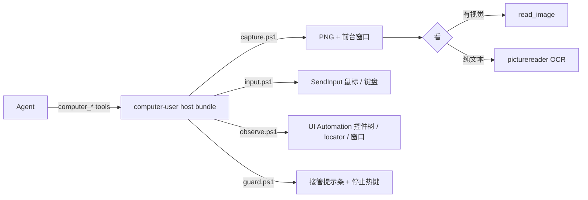

<div align="center">

# computer-user

**给 DeepSeek Harness 的 Windows 电脑操控插件（Codex 风格）。**
模型能看屏幕、点鼠标、敲键盘 —— 也能直接按名字操作 UI Automation 控件。没有 sidecar，不需要编译原生模块。

[](https://www.npmjs.com/package/computer-user)
[](https://www.npmjs.com/package/computer-user)
[](LICENSE)
[](#兼容性)
[](#开发)

[English](README.md) | 中文


</div>

`computer-user` 是 [DeepSeek Harness](https://github.com/deepseek-ai/deepseek-harness) 的一个 bundle，给 agent 提供
二十个 `computer_*` 工具：截图、UI Automation 控件树、鼠标键盘输入、窗口控制，以及一个带全局停止热键的接管提示条。

它就是一个普通 DSH 插件：`package.json` + 一份 `cordis.patch.yml` + 设置卡 + 三个 PowerShell 脚本。
没有原生插件、没有常驻 daemon、不走 MCP 桥。

## 为什么选这个

- **原生 DSH bundle，不是转接层。** 工具走 `ctx.tools.register`；设置走 0.2.x 的 `SettingsForms` 条目；
  Web 卡片是一等公民的 settings section，而不是另开一页。
- **零原生依赖。** 输入用 `SendInput`，截图用 GDI，观测用 UI Automation —— 全部走系统自带的
  Windows PowerShell 5.1。
- **视觉可选。** `computer_screenshot` 返回 PNG 路径：有视觉的模型调 `read_image`，纯文本模型用
  picturereader 的 OCR，而 `computer_snapshot` 完全不看像素、直接按控件名操作。
- **叫停就停。** agent 接管期间屏幕上方会出现蓝色提示条；按停止热键（默认 `Ctrl+Alt+Esc`）或点按钮
  会写停止标记，之后任何调用都会明确拒绝，直到用户重新批准。
- **不会点到旧位置。** 元素 id 每次动作都重新解析，截图还可以用 `expected_window` 做前台窗口围栏 ——
  界面变了就直接报错。

## 快速开始

npm：

```sh
npm install computer-user
```

DSH profile：

```sh
dsh plugin --profile desktop add computer-user
```

重启 DSH：工具在所有会话可用，设置卡出现在「设置 → 电脑操作」。

从源码：

```sh
git clone https://github.com/jing-hy/computer-user.git
cd computer-user
npm install --no-save @deepseek-ai/schemastery@3.18.5   # peer 依赖，运行时由宿主提供
node --test
```

## 闭环

```text
computer_screenshot            -> PNG 路径 + 前台窗口
read_image(path)               -> 有视觉的模型直接看图（纯文本用 image_ocr / image_scan）
computer_snapshot              -> UI Automation 控件树，每个元素一个可重放 id
computer_invoke / set_value    -> 按名字操作控件，不动鼠标
computer_screenshot            -> 验证（可传 expected_window 做围栏）
```

坐标方式同样保留：所有输入工具都收虚拟屏像素，`computer_screenshot` 返回 `virtual_offset`，多屏也对得上。

## 工具

二十个工具，三类。`tool_mode` 可以收敛到 9 个常用工具。

| 分组 | 工具 |
|---|---|
| 观测 | `computer_screenshot`、`computer_snapshot`、`computer_list_windows`、`computer_get_cursor_position` |
| 指针与键盘 | `computer_click`、`computer_type`、`computer_keypress`、`computer_scroll`、`computer_drag`、`computer_move_mouse` |
| 控件操作 | `computer_invoke`、`computer_set_value`、`computer_focus` |
| 窗口 | `computer_activate_window`、`computer_move_window`、`computer_close_window` |
| 等待 | `computer_wait` —— 固定等待，或等到窗口 / 元素 / 标题出现 |
| 运行时 | `computer_doctor`、`computer_browser`（只读 CDP 列表）、`computer_set_mode` |

元素 id 形如 `h=<hwnd>|r=<Role>|n=<Name>|i=<nth>`，每次动作都重新解析 —— 旧快照里的 locator 会报错，
而不是点到挪过去的新控件。

## 设置

「设置 → 电脑操作」这张卡写的是插件条目的 Config（所有字段都可热改）。

| 字段 | 默认 | 作用 |
|---|---|---|
| `mode` | `manual` | `disabled` 全拒；`readonly` 只允许观测；`manual` 需要 `/computer`；`auto` 自由调用 |
| `ai_can_change_mode` | `false` | AI 能否通过 `computer_set_mode` 自己改模式 |
| `screenshot_dir` | 空 | 截图输出目录（空 = 系统临时目录） |
| `default_scale` | `1` | 截图默认缩放 0.1–1 |
| `typing_interval_ms` | `0` | 逐字输入间隔 |
| `scroll_units` | `1` | 每次滚动的格数（每格 120 WHEEL delta） |
| `output_guard` | `true` | 把伪工具调用/XML 写成对话文本时打回；同内容第二次放行 |
| `debug` | `false` | 日志里打印 PowerShell 脚本路径 |
| `tool_mode` | `all` | `all` / `lite` / `custom` |
| `enabled_tools` | `[]` | `custom` 时的白名单（空 = 全部） |
| `stop_hotkey` | `ctrl+alt+esc` | 提示条上显示的停止热键；提示条按钮始终有效 |
| `takeover_minutes` | `30` | 提示条多久后自动收起（并停止）；`0` = 不自动收起 |
| `takeover_message` | 空 | 提示条标题；`{key}` 会替换成热键 |
| `cdp_port` | `0` | Chromium `--remote-debugging-port`，供 `computer_browser` 使用（`0` = 关闭） |
| `approve_observe` | `false` | 开启后，截图 / 控件快照 / 窗口列表在 `manual` 模式下也要 `/computer` |

## 安全模型

- **模式。** `disabled` / `readonly` / `manual` / `auto`；`readonly` 下观测工具仍然可用。
- **会话批准。** `manual` 下副作用工具拒绝执行，直到用户在该会话输入 `/computer`；再输一次撤销批准。
- **接管提示条与停止键。** 任何副作用调用都会拉起提示条（屏幕上方居中，蓝色圆角，显示「请勿操作鼠标」）。
  热键、提示条按钮或超时都会写停止标记；之后所有调用都返回明确的「已急停」错误，直到重新批准。
  提示条是独立进程，输入后端忙时热键依然有效。
- **观测也可以要求批准（可选）。** `approve_observe` 把批准要求扩展到截图与控件快照 —— 适合「看一眼屏幕
  本身也敏感」的场景。默认关闭。
- **过期拒绝。** locator 每次重新解析；截图可加 `expected_window` 围栏。

## 工作原理



宿主半侧注册工具并读取自己的 Config 条目；浏览器半侧（`client.js`）通过 `ctx.configForms` 和官方设置表单
的样式词汇渲染设置卡。

## 兼容性

| DSH | 状态 |
|---|---|
| 0.2.0-rc.1 … 0.2.2-alpha.2 | 支持；门禁为 `@deepseek-ai/dsh-settings >=0.1.0-rc.6 <0.3.0-0` |
| 0.1.0-rc.6 … 0.1.7-rc.2 | 支持，走 0.1.x 的命名空间 settings scope |
| 0.3.0 及以后 | 未验证，门禁不放行 |

Windows 10/11 x64；截图与 UIA 路径在 Windows PowerShell 5.1 上实测。

## 开发

```sh
node --test                      # 76 项：工具、门禁、提示条、设置卡、入口形状
```

布局：`src/index.js`（入口 / 命令 / 输出守卫）、`src/tools.js`（工具面与门禁）、`src/ps.js`（PowerShell 调用 +
提示条状态）、`src/capture.ps1` / `src/input.ps1` / `src/observe.ps1` / `src/guard.ps1`、`client.js`（设置卡）、
`tests/`。

## 许可

[MIT](LICENSE)
